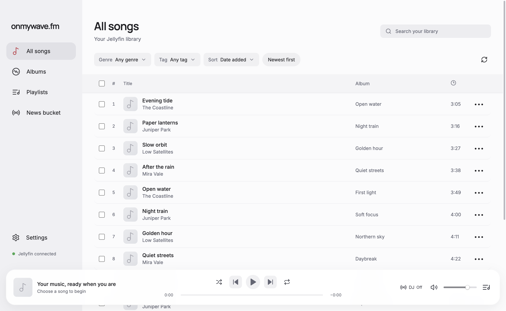

# onmywave.fm Light

A macOS music player for your Jellyfin library, with optional spoken news between songs.

[Download the latest release](https://github.com/wapgear/onmywave-desktop-light-app/releases/latest)

## What it does

- Browse and search songs and albums, with genre and tag filters.
- Create and edit Jellyfin playlists.
- Manage a listening queue with shuffle, repeat, and session restoration.
- Prepare spoken news from RSS, Hacker News, or X, then play it between songs.
- Choose a DJ voice and audition bundled samples without provider keys.

## Get started

1. Download the `.dmg` from the [latest release](https://github.com/wapgear/onmywave-desktop-light-app/releases/latest).
2. Open it and drag onmywave.fm Light into Applications.
3. Launch the app, enter your Jellyfin server URL, and sign in.
4. Select your music libraries and choose a song or album.

Requires macOS 12 or later on an Apple silicon Mac and your own Jellyfin server with music. Downloads are Developer ID signed and notarized by Apple. Automatic updates are not included.

Music playback needs no AI provider keys. Optional spoken news uses your own OpenAI and ElevenLabs keys, and X sources also require an X bearer token. Preparation and explicit preview generation can incur provider charges. Credentials are stored locally using protected storage where available.

## Releases and source

This repository hosts downloads and release notes. Each release includes a DMG, a ZIP, SHA-256 checksums, and the corresponding source archive with build instructions and license notices. The application code is licensed under GPL-3.0-only; bundled dependencies and media retain their applicable notices.

This is an early release. Real-server playback and playlist behavior have not been verified as part of packaging. Use this repository's issues to report bugs, and keep credentials and private server details out of reports.
